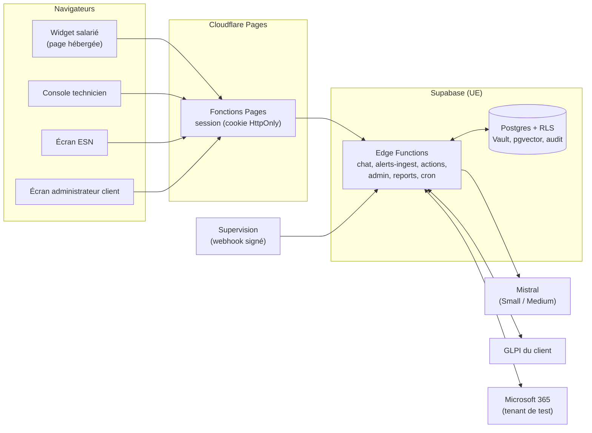
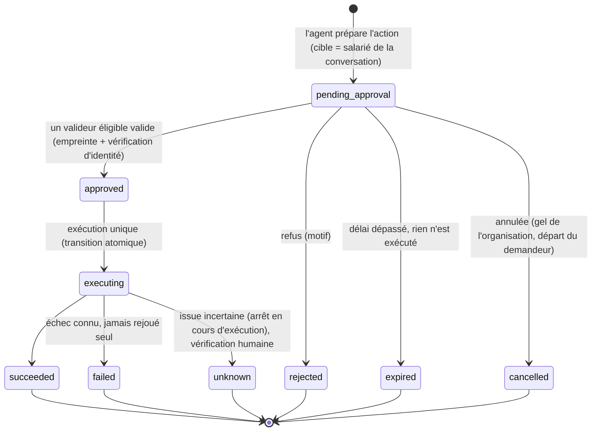

# Spécification de la démo de Relève IA (périmètre A)

| | |
|---|---|
| **Statut** | Brouillon pour accord du fondateur (jalon J1). Rien n'est construit tant que ce document n'est pas validé |
| **Version** | 1.0, 6 novembre 2026 |
| **Périmètre** | Uniquement le **périmètre A** de `docs/11-demo-resserree-et-fiabilite.md` § 1. Tout le reste est au backlog (`docs/backlog.md`) : le schéma et les interfaces l'accueillent, le code n'est pas écrit |
| **Documents liés** | `docs/threat-model.md` (menaces M01 à M40, invariants), `docs/securite-code-et-ci.md` (conventions de code), `docs/07-integrations.md` (capacités, alertes, suppléance), `docs/10-roles-administration-cockpits.md` (rôles), `docs/11-demo-resserree-et-fiabilite.md` (fiabilité, ESN revendeur) |

**Comment lire.** Les titres et les passages en gras suffisent pour saisir l'essentiel. Chaque exigence est marquée **P0** (la démo ne sort pas sans elle), **P1** (juste après, si le temps le permet) ou **P2** (hors démo, mais le schéma l'accueille). Les décisions déjà prises sont au § 1 ; ce qui reste ouvert est au § 17.

## 1. Décisions déjà prises (ne pas rediscuter)

| Sujet | Décision | Source |
|---|---|---|
| Première version | Une démo, pas un catalogue : GLPI, Microsoft 365, webhook de supervision, incident regroupé, suppléance, trois écrans et le widget | Fondateur, 6 nov. |
| Actions de niveau 1 | **Sur Microsoft 365, quatre seulement** : réinitialiser le MFA, réinitialiser le mot de passe, débloquer un compte, révoquer les sessions (tenant de test, comptes dédiés). S'y ajoute, dans GLPI, la **clôture des tickets enfants** d'un incident résolu, proposée par Relève et confirmée par un technicien | Fondateur, 6 nov. |
| Sécurité | Ne se réduit jamais. Vérification d'identité hors bande et refus d'une réinitialisation suspecte : non négociables | Fondateur, 6 nov. |
| Rôles actifs | `super_admin` (par script, sans écran), `partner_admin`, `partner_technician`, `org_admin`, `end_user`. Les cinq autres rôles existent dans le schéma | Fondateur, 6 nov. |
| Création de client par l'ESN | Autorisée ; la relation est créée active en même temps ; l'administrateur du client la confirme, la réduit ou la révoque seul | Fondateur, 5 nov. |
| Avant activation par le client | L'ESN **prépare** (GLPI, import des salariés par fichier, plannings) mais **aucune action de niveau 1 et aucune connexion Microsoft 365** tant que l'administrateur du client n'a pas activé son compte | Fondateur, 6 nov. |
| Incidents | **Incident regroupé** et **fin d'incident** dans la démo. Panne localisée au backlog. Panne Microsoft 365 reconnue : si le temps le permet (P1) | Fondateur, 6 nov. |
| Revendeur | Remise par paliers de 25, 30 et 35 % (seuils à fixer) ; aucun engagement pendant les pilotes puis 12 mois ; marque blanche sans mention (Relève reste nommé comme sous-traitant) ; kit de vente hors démo | Fondateur, 6 nov. |
| Qualité | Mode ombre, notation par les techniciens, barres de passage chiffrées avant toute réponse directe ou action élargie (§ 10) | Fondateur, 6 nov. |
| Données | Jamais de donnée réelle dans le dépôt (public). Jeu synthétique dans le dépôt, jeu réel dans un stockage privé | Fondateur, 6 nov. |

## 2. Problème, objectifs, non-objectifs

### Problème

Quand les techniciens d'une ESN ou d'une DSI sont absents (nuit, congés, astreinte), le support de niveau 1 s'arrête : les salariés attendent, les demandes simples s'accumulent, et au retour le technicien reprend un tas de tickets sans contexte. Les outils d'IA existants promettent l'autonomie ; les DSI les refusent parce qu'**une mauvaise action sur un compte est pire qu'une absence de réponse**. Relève prend la garde, traite le simple, prépare le reste, et **ne fait jamais rien sans qu'un humain nommé ait validé**.

### Objectifs de la démo

| # | Objectif | Comment on le mesure | Cible (hypothèse, à calibrer avec les pilotes) |
|---|---|---|---|
| G1 | **Aucune mauvaise action sur un compte** | Actions de niveau 1 préparées avec la bonne cible ; exécutions sur un mauvais compte | 100 % de bonnes cibles sur au moins 50 actions ; **zéro** exécution sur un mauvais compte |
| G2 | **Une qualité mesurée sur de vraies demandes, par catégorie** | Notes des techniciens en mode ombre, avec effectifs | Barres du § 10, mesurées sur au moins 300 demandes par catégorie avant de conclure |
| G3 | **Résoudre une part réelle des demandes de niveau 1 sans technicien** | Part des demandes résolues par Relève **et confirmées par l'utilisateur** | 30 % ou plus à la fin d'un pilote de 8 semaines (`docs/03`), sur les catégories ouvertes |
| G4 | **Des utilisateurs satisfaits** | Note donnée à la clôture | 4 sur 5 ou plus |
| G5 | **Une ESN qui peut revendre simplement** | Activation d'un nouveau client ; envoi du rapport mensuel | Client activé en **moins d'une journée** ; rapport à la marque de l'ESN envoyé en **un clic** |
| G6 | **Une passation de garde utile** | Un technicien de retour sait en 2 minutes ce qui a été traité, en attente, escaladé | Mesuré par la satisfaction des techniciens (`docs/03` § 5) |

### Non-objectifs (et pourquoi)

| Hors démo | Pourquoi |
|---|---|
| Autres connecteurs (Jira, iTop, Zabbix, Centreon, RMM...) et leurs `docker-compose` | Une DSI pardonne un connecteur manquant, pas une mauvaise action : on prouve d'abord la fiabilité |
| Autres actions de niveau 1 (boîtes mail, licences, groupes, arrivées et départs, scripts) | Chaque action est un risque supplémentaire ; quatre suffisent à démontrer le circuit |
| Niveau 2 (autonomie sur liste blanche) | N'existe pas pendant le pilote |
| Canal Teams (Bot Framework) | La démo porte sur le widget web. Hypothèse à confirmer (§ 17) |
| Écrans plateforme, direction, auditeur, salarié complet | Backlog n° 5. Les données d'audit existent ; seul l'écran manque |
| Panne localisée, automatisations de prévention et d'organisation | Dépendent de la qualité de l'inventaire de chaque client |
| Kit de vente de l'ESN, e-mail vers alerte, relais Relève, Active Directory local | Après le premier client payant |
| Entraînement ou ajustement d'un modèle | Inutile : base de connaissance et garde-fous suffisent |

## 3. Rôles et droits

Les droits se calculent **toujours dans le contexte d'une organisation**, jamais globalement (menace M27, invariant R2). Le **valideur** n'est pas un rôle mais une **capacité** attribuée par catégorie d'action à un `partner_technician` (ou, plus tard, à un `org_technician`).

| Rôle (actif dans la démo) | Voit | Peut | Ne peut pas |
|---|---|---|---|
| **`super_admin`** (le fondateur, par script) | L'état de la plateforme et la configuration des organisations | Créer, suspendre une ESN ou un client ; inviter le premier administrateur ; **demander** un accès d'assistance | Lire les données d'un client sans accès d'assistance actif (lecture seule, 4 h, approuvé par le client) |
| **`partner_admin`** (administrateur ESN) | Tous les clients de son ESN **qui ont approuvé la relation**, leurs indicateurs, le revenu et la marge | Créer ses clients, inviter leurs administrateurs, gérer les techniciens de l'ESN et leurs assignations, préparer les connecteurs et plannings, envoyer le rapport mensuel, fixer son prix client | Accéder à un client sans relation active ; dépasser les rôles approuvés par le client ; lire le contenu d'une conversation hors des clients où il est assigné |
| **`partner_technician`** | Les demandes, tickets, incidents et actions à valider des **seuls clients qui lui sont assignés**, tant que l'assignation est active | Répondre, noter les réponses de l'IA, valider ou refuser une action dans sa chaîne, déléguer son rôle (MFA récent) | Voir un client non assigné ; valider une action qui cible son propre compte ; étendre sa propre chaîne |
| **`org_admin`** (administrateur client) | Son organisation uniquement : support, accès, valideurs, connecteurs, qualité | Activer sa relation avec l'ESN et la **réduire ou la révoquer seul**, définir les chaînes de valideurs, régler le niveau d'autonomie (0 ou 1) par catégorie, approuver un accès d'assistance, réattribuer les validations d'un absent | Toucher aux autres clients ; voir le prix partenaire ou la marge de l'ESN |
| **`end_user`** (salarié) | Ses propres demandes | Poser une question, demander une action sur son compte, parler à un technicien | Voir les demandes des autres |

Rôles présents dans le schéma mais **sans écran ni parcours** en démo : `platform_support`, `partner_manager`, `org_technician`, `org_viewer`, `auditor`. Un client sans ESN (« client direct ») est aussi accepté par le schéma (organisation de type `client` sans relation) mais n'est pas détaillé ici (§ 17).

## 4. Parcours et user stories

Chaque story porte une priorité. Les critères d'acceptation des P0 sont en cases à cocher ; **ils incluent ce qui ne doit pas arriver**. Les textes d'interface sont en français d'abord, sans tiret cadratin.

### 4.1 Le salarié (`end_user`), dans le widget

*Sa question : « Je suis bloqué, qu'est-ce que je fais ? »*

| ID | En tant que salarié, je veux... | pour... | Prio |
|---|---|---|---|
| S1 | poser ma question et savoir tout de suite à qui je parle | ne pas attendre sans savoir (badge « Assistant IA » toujours visible, badge « Relève active » avec l'heure de retour d'un humain) | P0 |
| S2 | être guidé pas à pas pour une manipulation | résoudre seul un problème simple (« ça a marché » / « ça ne marche pas ») | P0 |
| S3 | demander « Parler à un technicien » à tout moment | ne jamais rester bloqué face à l'IA ; le résumé est transmis, je ne répète rien | P0 |
| S4 | demander une action sur mon compte (MFA, mot de passe, déblocage, sessions) | retrouver l'accès sans attendre | P0 |
| S5 | savoir où en est ma demande | ne pas relancer | P0 |
| S6 | être prévenu quand une panne en cours est rétablie | ne pas réessayer en vain | P0 |
| S7 | coller une capture d'écran | éviter de décrire une erreur | P1 |
| S8 | voir qu'une panne Microsoft 365 est connue, sans ouvrir de ticket inutile | gagner du temps | P1 |

**Critères d'acceptation**

- **S1** : [ ] le badge « Assistant IA » est visible dans toute conversation, sur chaque écran du widget ; [ ] lorsque la relève est active, le badge ambre indique l'heure de retour prévue ; [ ] la première réponse commence à s'afficher en streaming en moins de 2 secondes (indicateur de frappe immédiat) ; [ ] **jamais** de réponse présentée comme venant d'un humain.
- **Mode ombre (S1, S2)** : *Given* la catégorie de ma demande n'a pas franchi la barre de qualité, *When* j'envoie ma demande, *Then* je ne reçois **aucun texte produit par l'IA** : un message fixe m'indique qu'un technicien va répondre, avec le délai habituel, et un ticket qualifié est créé ; [ ] la réponse préparée par l'IA existe, mais n'est visible que d'un technicien.
- **S3** : [ ] le bouton « Parler à un technicien » est présent à toute étape, même en mode ombre et même quand le service du modèle est indisponible ; [ ] le technicien reçoit un résumé (catégorie, diagnostic déjà fait, ce que l'utilisateur a essayé).
- **S4** : [ ] l'agent **ne demande jamais de mot de passe** ni de code, et masque ce qu'il détecte avant tout stockage ; [ ] il déclenche la vérification d'identité hors bande (§ 9.3) ; [ ] il annonce « en attente de validation » avec le délai habituel ; [ ] si la demande est jugée suspecte (§ 9.4), il **refuse de la traiter dans le chat** et escalade à un humain avec le contexte, sans dire pourquoi à l'utilisateur d'une façon qui aiderait un attaquant ; [ ] la réponse est la même que le compte existe ou non.
- **S6** : [ ] quand l'alerte liée à mon incident passe à « résolue », je reçois un message ; [ ] mon ticket enfant n'est clos qu'après confirmation d'un technicien.

### 4.2 Le technicien (`partner_technician`), dans la console

*Sa question : « Quoi faire maintenant, et sur quel client ? »*

| ID | En tant que technicien, je veux... | pour... | Prio |
|---|---|---|---|
| T1 | une **file unifiée** de tous mes clients assignés, triée par urgence | traiter le plus important en premier sans changer d'outil | P0 |
| T2 | **noter chaque réponse préparée** par l'IA en moins de 5 secondes (Correcte, Partielle, Fausse, Dangereuse + motif en un clic) | que la qualité soit mesurée et que Relève ne s'ouvre que là où il est fiable | P0 |
| T3 | une **boîte de validation** : l'action exacte, sa cible, l'objectif, les effets, le diagnostic déjà fait, la vérification d'identité | valider ou refuser en connaissance de cause | P0 |
| T4 | que l'action s'exécute **avec mon identité** et non celle de l'IA | que le journal dise qui a validé quoi | P0 |
| T5 | valider **en tant que suppléant** quand le valideur est absent, avec un bandeau explicite | couvrir une absence sans compte partagé | P0 |
| T6 | **déléguer** mon rôle à un collègue nommé, pour des catégories et une durée limitées | m'absenter sans bloquer mes clients | P0 |
| T7 | une **vue incident** : alertes et demandes sur une même ligne de temps, un ticket parent | comprendre et traiter une panne d'un coup | P0 |
| T8 | un écran **« Pendant votre absence »** à mon retour | savoir en 2 minutes ce qui est résolu, en attente, escaladé, à surveiller | P0 |
| T9 | reprendre une conversation escaladée sans demander à l'utilisateur de répéter | gagner du temps | P0 |
| T10 | une palette de commandes `Ctrl K` | aller vite au clavier | P1 |
| T11 | valider depuis mon téléphone (console utilisable sur mobile ; installation en PWA) | rester d'astreinte sans ordinateur | P1 |

**Critères d'acceptation**

- **T1** : [ ] un technicien ne voit que les clients dont **la relation et son assignation sont actives** ; [ ] une assignation expirée ou une relation révoquée fait disparaître le client **à la requête suivante** ; [ ] chaque ligne indique le client, le type (incident, demande, validation), l'urgence et le délai de SLA lu dans GLPI s'il existe (affichage seul, aucune relance automatique en démo).
- **T2** : [ ] quatre boutons et un motif en un clic (source manquante, mauvaise version, hors périmètre, sur-confiance, autre) ; [ ] une note est rattachée au technicien, horodatée, **non modifiable** ; [ ] une note « Dangereuse » remet **immédiatement** la catégorie en conseil seul (§ 10.4).
- **T3** : [ ] l'écran montre l'action exacte (capacité, cible, paramètres) ; [ ] il indique si la vérification d'identité a réussi, et comment ; [ ] valider un autre contenu que celui affiché est **impossible** (empreinte, § 9.2) ; [ ] un technicien ne peut pas valider une action dont **il est la cible** ni une action qu'il a lui-même demandée.
- **T4** : [ ] l'exécution utilise le jeton délégué du valideur ; [ ] si le valideur n'a pas les droits Microsoft 365 suffisants, l'action échoue **sans repli** sur un autre compte.
- **T5/T6** : invariants I1 à I12 de `docs/threat-model.md` § 5. En particulier : [ ] créer une délégation exige une session réauthentifiée par MFA récemment ; [ ] durée maximale 30 jours, périmètre limité aux catégories choisies ; [ ] une délégation expirée ou révoquée **cesse d'agir au moment de l'exécution**, même si l'action était déjà validée ; [ ] l'administrateur du client et le valideur remplacé sont notifiés.
- **T8** : [ ] regroupe par client ce qui a été résolu par Relève, ce qui attend une validation, ce qui a été escaladé, et ce à surveiller ; [ ] chaque élément ouvre la conversation ou l'action concernée.

### 4.3 L'administrateur de l'ESN (`partner_admin`)

*Sa question : « Lequel de mes clients a besoin de moi maintenant, et est-ce que je gagne de l'argent ? »*

| ID | En tant qu'administrateur ESN, je veux... | pour... | Prio |
|---|---|---|---|
| E1 | un **tableau de tous mes clients**, trié par urgence, avec filtres par étiquette | savoir où intervenir | P0 |
| E2 | un **zoom sur un client** : tous les blocs se recalculent sur lui | descendre dans le détail | P0 |
| E3 | **créer un client** avec un formulaire simple et inviter son administrateur | l'activer en moins d'une journée | P0 |
| E4 | **assigner mes techniciens** à un client (rôle, date de fin) et retirer un technicien d'un coup quand il part | garder la maîtrise des accès | P0 |
| E5 | **préparer** un client avant son activation : brancher GLPI, importer les salariés (fichier), régler les plannings de relève | tenir l'activation rapide | P0 |
| E6 | un **rapport mensuel** à mon logo et mes couleurs, avec un bloc « prochaine étape », que je relis et envoie en un clic | prouver ma valeur à mon client | P0 |
| E7 | fixer **mon prix client** et voir **ma marge** par client | savoir ce que je gagne | P0 |
| E8 | un **tableau d'opportunités** (clients sans relève active, pilotes qui se terminent, clients ayant connu des absences) | savoir qui contacter | P0 |
| E9 | l'écran **« Qualité de Relève »** avec les vrais chiffres et leurs effectifs | rassurer mon client avec des faits | P0 |
| E10 | ma **marque blanche** : logo, couleurs, nom, expéditeur des rapports | revendre sous mon nom | P1 pour le domaine d'expéditeur, P0 pour logo et couleurs |

**Critères d'acceptation**

- **E3** : [ ] exige une session réauthentifiée par MFA récemment ; [ ] respecte le plafond de clients de l'offre partenaire ; [ ] **notifie** le super administrateur ; [ ] crée **en même temps** la relation, active ; [ ] un client déjà existant ne peut pas être rattaché sans l'accord de son administrateur ; [ ] le client créé **reste rattaché à l'ESN** et Relève ne le démarche jamais.
- **E5** : [ ] avant l'activation par l'administrateur du client, **aucune action de niveau 1** n'est exécutable et la connexion Microsoft 365 est **refusée** ; [ ] l'import de salariés ne crée aucun compte dans le système du client ; [ ] chaque import est audité.
- **E6** : [ ] tout chiffre de « temps gagné » ou de « valeur » est affiché comme une **estimation avec sa méthode** ; [ ] aucun pourcentage sans son effectif ; [ ] le rapport ne contient ni la marge ni le prix partenaire ; [ ] l'envoi utilise le domaine vérifié de l'ESN (sinon le rapport est téléchargeable, pas envoyé).
- **E7** : [ ] `partner_admin` et `super_admin` seuls lisent le prix partenaire et la marge ; [ ] l'administrateur du client ne les voit dans aucun écran, rapport ou export.

### 4.4 L'administrateur du client (`org_admin`)

*Sa question : « Mon support tient-il, et qui a accès à quoi ? »*

| ID | En tant qu'administrateur client, je veux... | pour... | Prio |
|---|---|---|---|
| A1 | **activer mon compte** (MFA) et voir la relation que l'ESN a créée | décider de la confirmer, de la réduire ou de la refuser | P0 |
| A2 | voir **qui a accès à quoi et jusqu'à quand**, et **révoquer en un clic** sans passer par l'ESN | garder la main sur mon SI | P0 |
| A3 | définir les **chaînes de valideurs** par catégorie d'action, et **réattribuer** les validations d'un absent qui n'a rien délégué | qu'aucune demande ne reste sans valideur | P0 |
| A4 | régler le **niveau d'autonomie** par catégorie (0 : conseil seul, 1 : action après validation) | n'ouvrir que ce que je maîtrise | P0 |
| A5 | **approuver ou refuser** un accès d'assistance demandé par Relève | garder la main sur mes données | P0 |
| A6 | voir l'**état du support** et la **qualité de Relève** | savoir si ça vaut ce que ça coûte | P0 |
| A7 | voir l'état de mes connecteurs et accorder le **consentement Microsoft 365** | contrôler ce que Relève peut lire | P0 |
| A8 | faire la **revue trimestrielle** des accès | rester en règle (NIS2) | P1 |

**Critères d'acceptation**

- **A1/A2** : [ ] la relation affichée indique les rôles approuvés, la date de fin (12 mois maximum) et chaque technicien assigné ; [ ] « Révoquer » coupe l'accès de l'ESN **immédiatement** (même une session déjà ouverte) et conserve l'historique ; [ ] l'ESN est notifiée.
- **A4** : [ ] toute modification exige une session réauthentifiée par MFA ; [ ] le niveau 1 est refusé tant que le connecteur Microsoft 365 n'est pas marqué comme **tenant de test** ou **production** par l'administrateur ; [ ] le niveau 2 n'existe pas dans l'interface.
- **A5** : [ ] l'accès d'assistance est limité à ce client, en **lecture seule**, 4 heures par défaut, non prolongeable sans nouvelle approbation ; [ ] le demandeur ne peut jamais l'approuver ; [ ] l'ouverture et la fermeture sont notifiées.

### 4.5 Le super administrateur (`super_admin`), par script

*Pas d'écran en démo.* Un script (fonction SQL appelée avec un compte dédié protégé par passkey, J8) permet de : créer une ESN et inviter son premier administrateur ; suspendre une ESN ou un client ; **demander** un accès d'assistance (l'approbation reste celle du client). **Aucune policy de lecture** ne lui donne accès aux données des clients.

### 4.6 Parcours d'administration

| Parcours | Étapes | Garde-fous |
|---|---|---|
| **Nouvelle ESN** | Le super administrateur lance le script → invitation de l'administrateur ESN → il active son compte avec MFA → il invite ses techniciens | Invitation à usage unique, expirante, rôle fixé côté serveur |
| **Nouveau client via une ESN** | L'ESN crée le client (formulaire) → relation créée active → l'ESN prépare (GLPI, salariés, plannings) → l'ESN invite l'administrateur du client → il active son compte, **confirme ou réduit** la relation → le niveau 1 devient possible | MFA, plafond, notification du super administrateur ; **aucune action ni connexion Microsoft 365 avant l'activation** |
| **Import des salariés** | Fichier CSV (nom, e-mail, service) ; lecture des utilisateurs depuis Microsoft Entra ID en **P1** | Aucune création de compte chez le client ; permission de lecture documentée une par une (`docs/permissions-graph.md`, J4) |
| **Départ d'un technicien ESN** | L'administrateur ESN le retire → assignations, délégations, sessions et places de valideur révoquées **de façon atomique** | Invariant R7 ; notification des clients concernés |
| **Fin de contrat ESN** | Le client révoque la relation → accès coupés immédiatement, historique conservé, export possible | Révocable par le client seul |
| **Client sans ESN (« client direct »)** | Accepté par le schéma ; non détaillé dans la démo | Voir § 17 |

## 5. Architecture et arborescence

### 5.1 Vue d'ensemble



### 5.2 Les Edge Functions et leur porte d'entrée

Chaque fonction commence par **une** vérification d'authentification (convention § 6), jamais par du métier.

| Fonction | Rôle | Garde d'entrée |
|---|---|---|
| `chat` | Conversation du salarié (streaming), RAG, mode ombre, création de ticket qualifié, préparation d'une `action_request` | `requireUser` (session salarié) puis `requireOrgMember` |
| `alerts-ingest` | Réception des alertes (webhook signé) et interrogation de l'état des services Microsoft 365 | `verifyWebhookSignature` (secret par source) |
| `actions` | Validation, refus et exécution des `action_request` | `requireOrgMember` (session avec second facteur) ; la validation exige en plus l'authentification Microsoft du valideur (§ 9.6) |
| `admin` | Organisations, invitations, relations, assignations, délégations, accès d'assistance, niveaux d'autonomie | `requireOrgMember` + `requireRecentMfa` |
| `reports` | Rapport de passation, rapport mensuel à la marque de l'ESN | `requireOrgMember` |
| `cron` | Expirations, silence des sources, purge, génération des rapports | `requireCronSecret` |

La **console lit en direct** avec le client Supabase (la RLS protège) et **écrit par les Edge Functions** pour tout ce qui est sensible (validation, délégation, relation, niveau d'autonomie). Le client Supabase du navigateur utilise la clé publique uniquement.

### 5.3 Session et jetons : décision technique à confirmer

Aucun jeton dans `localStorage` (CSP stricte, menace M15). Conception retenue :

- le **widget est une page hébergée** par Relève (`/w/<organisation>`), que l'intranet du client ouvre dans un onglet ou une fenêtre. L'**intégration par iframe** est un P1 : les navigateurs bloquent de plus en plus les cookies tiers, ce qui la fragilise ;
- une **fonction Pages** (même origine que le front) joue le rôle de « passerelle de session » : le jeton de rafraîchissement vit dans un cookie `__Host-` **HttpOnly**, `Secure`, `SameSite=Lax` ; le jeton d'accès (10 minutes) vit **en mémoire** du navigateur seulement ;
- **salariés** : connexion par code à usage unique envoyé à leur adresse professionnelle, **uniquement si l'adresse figure dans la liste des salariés importée** du client, **vérifiée avant l'envoi du code** et non après ; la conversation seule n'authentifie jamais une action sur un compte (§ 9.3) ;
- **techniciens et administrateurs** : e-mail, mot de passe et second facteur (TOTP) obligatoires ; « MFA récent » se lit dans la revendication `amr` du jeton (horodatage de la dernière vérification du second facteur, **à confirmer dans la documentation Supabase en J2**).

### 5.4 Arborescence du dépôt

```
app/                          Front React + Vite + TypeScript (Cloudflare Pages)
  src/widget/                 Widget salarié (thème clair par défaut)
  src/console/                Console technicien (thème sombre par défaut)
  src/esn/                    Écran ESN
  src/client/                 Écran administrateur client
  src/ui/                     Système de design « Signal » (tokens de docs/04)
  src/lib/                    Client Supabase, i18n (fr puis en), formats
  functions/api/session/      Fonctions Pages : passerelle de session
supabase/
  migrations/                 Migrations (appliquées par le fondateur)
  seed/                       Données de démonstration SYNTHÉTIQUES
  tests/                      Scripts SQL de test d'isolation
  functions/
    _shared/auth.ts           requireUser, requireOrgMember, requireRecentMfa, verifyWebhookSignature, requireCronSecret
    _shared/db.ts             serviceClient(auth) : seul accès service_role
    _shared/log.ts            log.* et redact()
    _shared/llm/              Couche LLM abstraite, prompts statiques, wrapExternal, garde-fous
    _shared/capabilities/     Registre des capacités, callCapability()
    _shared/actions/          Machine à états, empreinte, validateurs, executeApprovedAction()
    _shared/connectors/       types.ts, glpi/, m365/, demo/
    _shared/alerts/           Normalisation, déduplication, regroupement, silence
    _shared/automations/      Moteur de règles et règles livrées
    chat/  alerts-ingest/  actions/  admin/  reports/  cron/
eval/
  synthetic/                  Jeu d'évaluation synthétique (en CI)
  promptfoo/                  Configuration des tests offensifs et de qualité
docker/glpi/                  docker-compose GLPI pour le développement
security/                     Règles Semgrep et verrous d'outils (J0)
docs/  scripts/  .github/
```

## 6. Conventions de code figées

Ces noms sont **ceux que les règles Semgrep de J0 imposent** (`docs/securite-code-et-ci.md` § 2) ; ils ne changent plus sans modifier les règles et leurs tests.

| Nom | Signature | Rôle |
|---|---|---|
| `AuthContext` | `{ userId, orgId, role, aal, mfaAt, requestId }` | Preuve (par le type) qu'une authentification et une appartenance ont été vérifiées pour **cette** requête |
| `requireUser(req)` | `Promise<AuthContext>` | Vérifie le JWT |
| `requireOrgMember(req, orgId, roles?)` | `Promise<AuthContext>` | Vérifie le JWT, l'appartenance, le rôle, et pour une ESN la relation **et** l'assignation actives |
| `requireRecentMfa(auth, maxAgeSeconds)` | `AuthContext` | Refuse si le second facteur est plus ancien que la limite (défaut : 600 s) |
| `verifyWebhookSignature(req)` | `Promise<SourceContext>` | Signature HMAC d'une source d'alertes, horodatage anti-rejeu |
| `requireCronSecret(req)` | `void` | Appels planifiés internes |
| `serviceClient(auth)` | `SupabaseClient` | **Seul** moyen d'obtenir un client `service_role` |
| `log.info/warn/error(événement, champs)`, `redact(valeur)` | | Journalisation avec masquage |
| `SYSTEM_PROMPT`, `getSystemPrompt()` | `string` | Prompt système **statique** versionné |
| `wrapExternal(étiquette, donnée)` | `string` | Encadre un contenu externe comme **donnée** dans un message `user` |
| `callCapability(ctx, nom, params)` | | Porte des capacités de lecture et autonomes ; applique `assertCapabilityAllowed` |
| `executeApprovedAction(actionRequestId)` | | Porte des actions privilégiées ; appelle `assertApprovedActionRequest` |
| `connector.invokeCapability(...)` | | Appel brut, **réservé** aux deux portes |

## 7. Contrat des capacités (TypeScript)

L'agent ne connaît ni GLPI ni Microsoft 365 : il connaît des **capacités** (`docs/07` § 1). Le contrat déclare **toutes** les capacités prévues pour que le backlog s'y ajoute sans refonte ; seules celles marquées `demo` sont implémentées. Fichier cible : `supabase/functions/_shared/capabilities/types.ts`.

```ts
// Famille et nom : tous déclarés, seuls ceux de DEMO_CAPABILITIES sont implémentés.
export type CapabilityName =
  // Ticketing
  | 'ticket.create' | 'ticket.get' | 'ticket.search' | 'ticket.comment'
  | 'ticket.update_status' | 'ticket.assign' | 'ticket.link_parent' | 'kb.search'
  // Identité et messagerie (Microsoft 365)
  | 'user.diagnose' | 'user.reset_password' | 'user.unlock' | 'user.revoke_sessions'
  | 'user.mfa_reregister' | 'tenant.service_health'
  | 'mailbox.diagnose' | 'mailbox.grant_shared_access' | 'mailbox.set_auto_reply'
  | 'mailbox.set_forwarding' | 'license.assign' | 'group.add_member'
  | 'user.onboard' | 'user.offboard' | 'tenant.license_usage'
  // RMM et parc
  | 'device.find_by_user' | 'device.health' | 'device.patch_status'
  | 'device.backup_status' | 'script.run'
  // Prise en main à distance
  | 'remote.create_session' | 'remote.session_status'
  // Supervision
  | 'alert.ingest' | 'alert.list_active' | 'alert.acknowledge' | 'host.status';

/** autonomous : l'agent l'appelle seul. approval_required : action_request validée par un humain. forbidden : jamais. */
export type ActionClass = 'autonomous' | 'approval_required' | 'forbidden';

/** Catégories d'action pour les chaînes de valideurs et le niveau d'autonomie (docs/07 § 5). */
export type ApprovalCategory = 'accounts' | 'mailboxes' | 'licenses' | 'scripts' | 'tickets';

export interface CapabilityMeta {
  readonly family: 'ticketing' | 'identity' | 'device' | 'remote' | 'monitoring';
  readonly effect: 'read' | 'write';
  /** Classe par défaut ; une organisation peut la durcir, jamais l'assouplir. */
  readonly class: ActionClass;
  readonly category: ApprovalCategory;
  /** La cible doit être l'utilisateur authentifié de la conversation, ou choisie par un technicien. */
  readonly targetPolicy: 'none' | 'self_only' | 'technician_chosen';
  readonly requiresIdentityCheck: boolean;
  /** Implémentée dans la démo. */
  readonly demo: boolean;
}

// `as const satisfies` : vérifie que toutes les capacités sont décrites SANS élargir les types littéraux
// (sinon PrivilegedCapability ci-dessous serait vide).
export const CAPABILITIES = {
  'ticket.create':        { family: 'ticketing', effect: 'write', class: 'autonomous',        category: 'tickets',  targetPolicy: 'none',              requiresIdentityCheck: false, demo: true },
  'ticket.get':           { family: 'ticketing', effect: 'read',  class: 'autonomous',        category: 'tickets',  targetPolicy: 'none',              requiresIdentityCheck: false, demo: true },
  'ticket.search':        { family: 'ticketing', effect: 'read',  class: 'autonomous',        category: 'tickets',  targetPolicy: 'none',              requiresIdentityCheck: false, demo: true },
  'ticket.comment':       { family: 'ticketing', effect: 'write', class: 'autonomous',        category: 'tickets',  targetPolicy: 'none',              requiresIdentityCheck: false, demo: true },
  'ticket.link_parent':   { family: 'ticketing', effect: 'write', class: 'autonomous',        category: 'tickets',  targetPolicy: 'none',              requiresIdentityCheck: false, demo: true },
  'ticket.update_status': { family: 'ticketing', effect: 'write', class: 'approval_required', category: 'tickets',  targetPolicy: 'none',              requiresIdentityCheck: false, demo: true },
  'ticket.assign':        { family: 'ticketing', effect: 'write', class: 'approval_required', category: 'tickets',  targetPolicy: 'none',              requiresIdentityCheck: false, demo: false },
  'kb.search':            { family: 'ticketing', effect: 'read',  class: 'autonomous',        category: 'tickets',  targetPolicy: 'none',              requiresIdentityCheck: false, demo: true },

  'user.diagnose':        { family: 'identity', effect: 'read',  class: 'autonomous',         category: 'accounts', targetPolicy: 'self_only',         requiresIdentityCheck: false, demo: true },
  'tenant.service_health':{ family: 'identity', effect: 'read',  class: 'autonomous',         category: 'accounts', targetPolicy: 'none',              requiresIdentityCheck: false, demo: true },
  'user.reset_password':  { family: 'identity', effect: 'write', class: 'approval_required',  category: 'accounts', targetPolicy: 'self_only',         requiresIdentityCheck: true,  demo: true },
  'user.unlock':          { family: 'identity', effect: 'write', class: 'approval_required',  category: 'accounts', targetPolicy: 'self_only',         requiresIdentityCheck: true,  demo: true },
  'user.revoke_sessions': { family: 'identity', effect: 'write', class: 'approval_required',  category: 'accounts', targetPolicy: 'self_only',         requiresIdentityCheck: true,  demo: true },
  'user.mfa_reregister':  { family: 'identity', effect: 'write', class: 'approval_required',  category: 'accounts', targetPolicy: 'self_only',         requiresIdentityCheck: true,  demo: true },

  'alert.ingest':         { family: 'monitoring', effect: 'write', class: 'autonomous',       category: 'tickets',  targetPolicy: 'none',              requiresIdentityCheck: false, demo: true },
  'alert.list_active':    { family: 'monitoring', effect: 'read',  class: 'autonomous',       category: 'tickets',  targetPolicy: 'none',              requiresIdentityCheck: false, demo: true },
  'host.status':          { family: 'monitoring', effect: 'read',  class: 'autonomous',       category: 'tickets',  targetPolicy: 'none',              requiresIdentityCheck: false, demo: false },
  'alert.acknowledge':    { family: 'monitoring', effect: 'write', class: 'approval_required', category: 'tickets', targetPolicy: 'none',              requiresIdentityCheck: false, demo: false },

  // Backlog : déclarées « interdites » tant que leur connecteur et leurs tests n'existent pas.
  'mailbox.diagnose':           { family: 'identity', effect: 'read',  class: 'forbidden', category: 'mailboxes', targetPolicy: 'self_only',         requiresIdentityCheck: false, demo: false },
  'mailbox.grant_shared_access':{ family: 'identity', effect: 'write', class: 'forbidden', category: 'mailboxes', targetPolicy: 'technician_chosen', requiresIdentityCheck: true,  demo: false },
  'mailbox.set_auto_reply':     { family: 'identity', effect: 'write', class: 'forbidden', category: 'mailboxes', targetPolicy: 'self_only',         requiresIdentityCheck: true,  demo: false },
  'mailbox.set_forwarding':     { family: 'identity', effect: 'write', class: 'forbidden', category: 'mailboxes', targetPolicy: 'self_only',         requiresIdentityCheck: true,  demo: false },
  'license.assign':             { family: 'identity', effect: 'write', class: 'forbidden', category: 'licenses',  targetPolicy: 'technician_chosen', requiresIdentityCheck: false, demo: false },
  'group.add_member':           { family: 'identity', effect: 'write', class: 'forbidden', category: 'accounts',  targetPolicy: 'technician_chosen', requiresIdentityCheck: true,  demo: false },
  'user.onboard':               { family: 'identity', effect: 'write', class: 'forbidden', category: 'accounts',  targetPolicy: 'technician_chosen', requiresIdentityCheck: false, demo: false },
  'user.offboard':              { family: 'identity', effect: 'write', class: 'forbidden', category: 'accounts',  targetPolicy: 'technician_chosen', requiresIdentityCheck: false, demo: false },
  'tenant.license_usage':       { family: 'identity', effect: 'read',  class: 'forbidden', category: 'licenses',  targetPolicy: 'none',              requiresIdentityCheck: false, demo: false },
  'device.find_by_user':        { family: 'device',   effect: 'read',  class: 'forbidden', category: 'scripts',   targetPolicy: 'self_only',         requiresIdentityCheck: false, demo: false },
  'device.health':              { family: 'device',   effect: 'read',  class: 'forbidden', category: 'scripts',   targetPolicy: 'self_only',         requiresIdentityCheck: false, demo: false },
  'device.patch_status':        { family: 'device',   effect: 'read',  class: 'forbidden', category: 'scripts',   targetPolicy: 'none',              requiresIdentityCheck: false, demo: false },
  'device.backup_status':       { family: 'device',   effect: 'read',  class: 'forbidden', category: 'scripts',   targetPolicy: 'none',              requiresIdentityCheck: false, demo: false },
  'script.run':                 { family: 'device',   effect: 'write', class: 'forbidden', category: 'scripts',   targetPolicy: 'technician_chosen', requiresIdentityCheck: true,  demo: false },
  'remote.create_session':      { family: 'remote',   effect: 'write', class: 'forbidden', category: 'scripts',   targetPolicy: 'self_only',         requiresIdentityCheck: true,  demo: false },
  'remote.session_status':      { family: 'remote',   effect: 'read',  class: 'forbidden', category: 'scripts',   targetPolicy: 'none',              requiresIdentityCheck: false, demo: false },
} as const satisfies Readonly<Record<CapabilityName, CapabilityMeta>>;

export type PrivilegedCapability = {
  [N in CapabilityName]: (typeof CAPABILITIES)[N]['class'] extends 'approval_required' ? N : never;
}[CapabilityName];

/** Entrées et sorties des capacités de la démo (les autres s'ajoutent avec leur connecteur). */
export interface CapabilityIO {
  'ticket.create':        { params: { title: string; body: string; category: string; priority: 'low' | 'normal' | 'high' | 'urgent'; requesterRef: string; diagnosticSummary?: string; parentRef?: string }; result: { ref: string; url: string } };
  'ticket.get':           { params: { ref: string }; result: TicketView };
  'ticket.search':        { params: { query: string; limit?: number }; result: TicketView[] };
  'ticket.comment':       { params: { ref: string; body: string; internal: boolean }; result: { ok: true } };
  'ticket.link_parent':   { params: { parentRef: string; childRef: string }; result: { ok: true } };
  'ticket.update_status': { params: { ref: string; status: 'solved' | 'closed' | 'pending' }; result: { ok: true } };
  'kb.search':            { params: { query: string; limit?: number }; result: { chunkId: string; documentId: string; text: string; score: number }[] };
  'user.diagnose':        { params: { userRef: string }; result: UserDiagnosis };
  'tenant.service_health':{ params: Record<string, never>; result: ServiceHealth[] };
  'user.reset_password':  { params: { userRef: string }; result: { ok: true; temporaryPasswordDeliveredTo: 'technician' } };
  'user.unlock':          { params: { userRef: string }; result: { ok: true } };
  'user.revoke_sessions': { params: { userRef: string }; result: { ok: true } };
  'user.mfa_reregister':  { params: { userRef: string }; result: { ok: true } };
  'alert.ingest':         { params: { alert: NormalizedAlertInput }; result: { alertId: string; deduplicated: boolean } };
  'alert.list_active':    { params: { assetRef?: string }; result: NormalizedAlert[] };
}

export type DemoCapability = keyof CapabilityIO;

export interface TicketView { ref: string; url: string; title: string; status: string; category?: string; updatedAt: string }
export interface UserDiagnosis {
  accountEnabled: boolean; locked: boolean;
  mfaMethods: { type: string; createdAt: string }[];
  lastPasswordChangeAt?: string;
  recentFailedSignIns: number;
  hasPrivilegedRole: boolean;
}
export interface ServiceHealth { service: string; status: 'operational' | 'degraded' | 'incident'; summary?: string; url?: string }

export interface InvocationContext {
  readonly orgId: string;
  readonly connectorId: string;
  readonly requestId: string;
  /** Qui agit. L'agent n'a jamais de jeton d'administration. */
  readonly actor:
    | { kind: 'agent'; conversationId: string }
    | { kind: 'system'; reason: 'cron' | 'webhook' | 'automation' }
    | { kind: 'human'; userId: string; delegatedToken: string; viaDelegationId?: string };
  readonly actionRequestId?: string;
  readonly idempotencyKey?: string;
}

export interface ConnectorHealth { ok: boolean; checkedAt: string; detail?: string }

export interface Connector {
  readonly id: string;
  readonly type: 'glpi' | 'm365' | 'demo';
  /** Un connecteur de niveau 1 doit être qualifié « test » ou « production » par l'administrateur du client (menace M22). */
  readonly environment: 'test' | 'production';
  capabilities(): ReadonlySet<CapabilityName>;
  invokeCapability<N extends DemoCapability>(
    name: N, params: CapabilityIO[N]['params'], ctx: InvocationContext,
  ): Promise<CapabilityIO[N]['result']>;
  health(ctx: InvocationContext): Promise<ConnectorHealth>;
}
```

**Règles du contrat.**
- Une capacité de classe `approval_required` n'est **jamais** appelée par l'agent : il crée une `action_request` (§ 9). Une organisation peut **durcir** une classe, jamais l'assouplir.
- `targetPolicy: 'self_only'` : la cible est l'utilisateur authentifié **de la conversation**, jamais une valeur lue dans un message, un ticket ou une alerte.
- Un nouveau connecteur déclare ses capacités et fournit ses tests ; il ne modifie ni l'orchestrateur ni le registre, sauf pour passer une capacité de `forbidden` à sa vraie classe, ce qui exige une revue de sécurité (mise à jour du modèle de menace).
- Le connecteur « démo » implémente le même contrat avec des données fictives et **aucun accès réseau**.

## 8. Schéma de données

Les migrations sont écrites en J2 ; **chacune doit être appliquée par le fondateur** (signalé à chaque fois). Toute table a la RLS activée dans sa migration. Les fonctions de contrôle : `is_member_of(org)`, `has_role(org, role)`, `org_has_feature(org, feature)`, `partner_can_access(client_org, min_role)` (relation **et** assignation actives, évaluées à la lecture), `recent_mfa(max_age_seconds)`.

| Groupe | Table | Contenu clé | Lecture | Écriture |
|---|---|---|---|---|
| **Organisations** | `organizations` | `type` (`platform`, `partner`, `client`), nom, `slug`, état, `labels`, `plan`, `autonomy_default`, `branding`, `created_via_partner_id` (ESN créatrice, pour la facturation) | membres ; ESN via `partner_can_access` | `admin` (MFA récent) |
| | `memberships` | utilisateur, organisation, **rôle** (les 10 rôles), état | soi-même ; `org_admin` et `partner_admin` de l'organisation | `admin` |
| | `directory_users` | salariés importés : e-mail, nom, service, e-mail du manager, source (`csv`, `entra`) | `org_admin` ; techniciens assignés | `admin` (import audité) |
| **Accès** | `partner_relationships` | ESN, client, **rôles approuvés**, état (`active`, `reduced`, `suspended`, `revoked`, `expired`), `created_by_partner`, `confirmed_at`, `expires_at` (12 mois maximum), `revoked_at` | les deux parties | création par l'ESN ; confirmation, réduction et **révocation par le client seul** |
| | `partner_assignments` | relation, technicien, rôle, `starts_at`, `ends_at`, `revoked_at` | `partner_admin`, le technicien, `org_admin` du client | `partner_admin` |
| | `support_access_grants` | client, demandeur, **motif**, approbateur (≠ demandeur), `ends_at` (4 h par défaut), `revoked_at`, `scope = read_only` | `org_admin` du client, demandeur | demande : `super_admin` ; approbation : client |
| | `invitations` | organisation, e-mail, rôle fixé, `token_hash`, `expires_at`, `used_at` | `org_admin` / `partner_admin` | `admin` |
| | `access_reviews` | période, éléments, décisions | `org_admin`, `partner_admin` | idem (P1) |
| **Support** | `conversations` | organisation, salarié, canal, catégorie, état, `relief_active`, résumé | techniciens assignés ; le salarié pour les siennes | `chat` |
| | `messages` | contenu **masqué**, rôle (`user`, `assistant`, `technician`), **`visibility`** (`public`, `technician`), modèle et version du prompt | idem, **le salarié ne lit que `public`** | `chat` |
| | `tickets` | miroir local : connecteur, référence externe, parent, catégorie, priorité, état, échéance de SLA lue dans GLPI | techniciens assignés, `org_admin` | `chat`, automatisations |
| | `incidents` | titre, gravité, état, ticket parent, alertes et conversations rattachées | idem | automatisations |
| **Connaissance** | `kb_documents` | titre, source, `status` (`draft`, `validated`), version, empreinte | membres | `admin` (publication par un humain) |
| | `kb_chunks` | `org_id`, texte, `embedding vector(1024)` avec index **HNSW** | via `match_kb_chunks` seulement | `admin` |
| **Relève** | `relief_schedules` | plages d'absence ou de nuit, technicien, récurrence | membres | `org_admin`, `partner_admin` |
| | `handover_reports` | période, technicien, contenu, lu le | le technicien concerné, `org_admin` | `cron` |
| **Connecteurs** | `connectors` | type, **`environment`** (`test`, `production`), état, config **non secrète**, `vault_secret_id`, qualifié par, dernière synchronisation | `org_admin`, `partner_admin` ; **jamais les secrets** | `admin` |
| **Alertes** | `alert_sources` | type (`webhook`, `api_poll`), secret (Vault), **table des gravités**, intervalle attendu, dernier signe de vie | `org_admin`, `partner_admin` | idem |
| | `maintenance_windows` | source ou actif, début, fin, motif | idem | idem |
| | `alerts` | format normalisé (§ 11), `dedup_key`, état, **`attachment_status`** (`attached`, `unattached`), `raw` (donnée, jamais exécutée) | techniciens assignés, `org_admin` | `alerts-ingest` |
| | `alert_events` | historique des changements d'état | idem | idem |
| | `asset_links` | motif d'actif (hôte, service) vers **catégorie** de demande et site : c'est ce qui permet de rapprocher une alerte des demandes. Sans lien, l'alerte reste « non rattachée » | `org_admin`, `partner_admin` | idem |
| **Actions** | `action_requests` | capacité, cible, paramètres, **`params_hash`**, état (§ 9.1), vérification d'identité, valideur effectif, délégation utilisée, `idempotency_key`, expiration | techniciens concernés, demandeur | `chat` (création), `actions` (transitions) |
| | `approval_policies` | catégorie, **chaîne ordonnée** de valideurs, délai | `org_admin`, `partner_admin` | `org_admin` |
| | `approval_delegations` | délégant, délégué, catégories, début, fin (**≤ 30 jours**, contrainte de base), MFA au moment de la création, révocation | parties, `org_admin` | `admin` (MFA récent) |
| **Automatisations** | `automation_rules` | déclencheur, conditions, action, **niveau d'autonomie**, plafonds, `dry_run`, version | `org_admin`, `partner_admin` | `org_admin` (MFA récent) |
| | `automation_runs` | règle, déclencheur, décision, résultat, lien vers l'`action_request` | idem | moteur |
| **Qualité** | `response_ratings` | message, catégorie, **note** (`correct`, `partial`, `wrong`, `dangerous`), motif, technicien, date. **Insertion seule** | `org_admin`, `partner_admin`, techniciens | techniciens assignés |
| | `category_gates` | organisation, catégorie, **état** (`shadow`, `direct`, `advice_only`), dernière décision, effectifs | `org_admin`, `partner_admin` | moteur de décision (§ 10.4) ; ouverture validée par un humain |
| **Revendeur** | `partner_pricing` | ESN, client, palier, **prix partenaire**, **prix client**, devise | **`partner_admin` et `super_admin` seulement** | `partner_admin` (prix client) |
| | `monthly_reports` | ESN, client, période, état (`draft`, `reviewed`, `sent`), contenu, marque appliquée | `partner_admin`, `org_admin` (sans marge) | `reports` |
| **Pilotage** | `llm_usage` | organisation, modèle, jetons, délai, coût estimé | `partner_admin`, `org_admin` (agrégé) | `chat` |
| **Audit** | `audit_logs` | acteur, **pour le compte de**, événement, objet, détails masqués, identifiant de requête. **INSERT seulement**, aucun droit de modification ni de suppression, même pour `service_role` | `org_admin` ; `super_admin` : événements de plateforme | `serviceClient` uniquement |

**Rôles dans le schéma (10)** : `super_admin`, `platform_support`, `partner_admin`, `partner_manager`, `partner_technician`, `org_admin`, `org_technician`, `org_viewer`, `auditor`, `end_user`. Cinq sont actifs en démo (§ 3).

**Conservation (propositions, à valider en J7).** Conversations et réponses de l'IA : 90 jours, durée réglable par organisation ; charges brutes d'alerte : 30 jours ; notes de qualité et décisions de catégorie : durée du contrat ; journal d'audit : 12 mois minimum (la CNIL recommande 6 mois à 1 an pour les traces d'accès). Une purge planifiée supprime les conversations échues.

**Secrets.** Clés des connecteurs et secrets de webhook dans Supabase Vault ; jamais dans une colonne, jamais renvoyés au navigateur, jamais dans un prompt ni un journal.

## 9. Le circuit des actions de niveau 1

C'est le point qui fera accepter ou refuser Relève par une DSI (`docs/07` § 4). Principe : **l'IA prépare, un humain nommé valide, l'action s'exécute avec l'identité de cet humain.**

### 9.1 États d'une `action_request`



Seule la fonction `actions` fait avancer les états ; chaque transition écrit une ligne d'audit. **Une action `unknown` ou `failed` n'est jamais relancée automatiquement** (menace M13) : un humain vérifie puis crée une nouvelle demande.

### 9.2 Empreinte et idempotence (menaces M12, M13)

- À la création, la demande est figée : capacité, organisation, cible, paramètres. `params_hash = SHA-256(organisation, capacité, cible, paramètres en JSON canonique à clés triées)`.
- L'écran de validation affiche **le contenu stocké** ; la validation envoie l'empreinte vue ; le serveur refuse si elle diffère de l'empreinte stockée. Après approbation, seul l'état change.
- `idempotency_key` unique par (organisation, capacité, cible, empreinte) tant qu'une demande est ouverte : un double clic ou une relance ne crée pas deux exécutions.
- Le passage `approved` vers `executing` est une écriture conditionnelle (`WHERE status = 'approved'`) : au plus une exécution.

### 9.3 Vérification d'identité hors bande (non négociable)

Le chat **n'authentifie jamais** une action sur un compte : la réponse d'une personne dans la conversation ne vaut pas preuve. Dans la démo, la vérification est faite **par le valideur** avant de valider, par un canal différent de la conversation :

| Méthode | Ce que fait le valideur |
|---|---|
| `callback` | Rappelle le salarié au numéro de l'**annuaire** (jamais celui donné dans le chat) |
| `manager_confirmation` | Obtient la confirmation du responsable par un canal connu |
| `in_person` | Constate l'identité sur place |

La validation est **impossible côté serveur** tant qu'une méthode n'est pas enregistrée (valideur, heure). Un code envoyé automatiquement au responsable est un **P1**.

### 9.4 Demande suspecte : refus dans le chat

Règles **déterministes**, évaluées par le code (jamais par le modèle) sur `UserDiagnosis` et la demande. Seuils de départ, à calibrer :

| Règle | Condition | Effet |
|---|---|---|
| X1 | Le compte cible a un **rôle à privilèges** | Aucune action préparée ; escalade humaine systématique |
| X2 | Méthode MFA ajoutée ou mot de passe changé depuis **moins de 24 h** | Suspecte |
| X3 | **10 échecs de connexion ou plus** récents | Suspecte |
| X4 | **2 demandes** de réinitialisation sur la même cible en 24 h | Suspecte |
| X5 | La cible n'est pas l'utilisateur authentifié de la conversation (« pour mon collègue ») | Refus : la politique `self_only` l'interdit |

**Effet d'une demande suspecte :** l'agent répond d'une façon neutre (« je ne peux pas traiter cette demande ici, un technicien va vous contacter »), sans dire quelle règle a joué ; un ticket de sécurité de priorité haute est créé avec le contexte ; l'astreinte est prévenue ; l'événement est audité. La réponse est identique que le compte existe ou non.

### 9.5 Chaîne de valideurs et suppléance

Pour une demande de catégorie *C* dans l'organisation *O*, les valideurs éligibles sont évalués dans cet ordre (`approval_policies`) :

1. le technicien **d'astreinte** selon les plannings de relève ;
2. ses **suppléants** (délégations actives couvrant *C*), puis les suivants de la chaîne ;
3. en dernier recours, **l'ESN**, seulement si la chaîne le prévoit **et** si la relation et l'assignation sont actives.

Un valideur est éligible si : membre assigné de *O* avec la capacité de valider *C* ; ni le demandeur ni la cible (invariant I2) ; la relation ESN-client et son assignation actives **à cet instant** (R3, R4). Après le délai d'un niveau (15 minutes par défaut), le niveau suivant est notifié. **Si personne ne valide**, la demande reste `pending_approval`, l'utilisateur est prévenu du délai, le ticket est escaladé, **rien ne s'exécute** (I8). Une demande expire au bout de 24 heures par défaut.

Les 12 invariants de suppléance (`docs/threat-model.md` § 5) sont des **critères d'acceptation** de J2, J3 et J6.

### 9.6 Exécution avec l'identité du valideur

- Au moment de valider, la console demande au valideur une **authentification Microsoft** (fenêtre de connexion, silencieuse si la session existe) pour obtenir un jeton **délégué** aux permissions limitées aux quatre actions. Le jeton est **transmis une fois, utilisé dans la même requête, jamais stocké**. L'exécution a donc lieu pendant la validation : les contrôles d'éligibilité et de délégation sont revérifiés à cet instant (I5).
- Les permissions déléguées sont limitées par les rôles Entra du valideur lui-même : une escalade de privilège passant par Relève est impossible par construction. **Aucune permission d'application en écriture** (menace M05). Liste des permissions : `docs/permissions-graph.md` (J4), une par une, avec revue de minimisation.
- Si le valideur n'a pas les droits suffisants, l'action **échoue sans repli** sur un autre compte.
- Le journal indique : qui a demandé, qui a validé, par quelle délégation, quelle vérification d'identité, quel résultat.

### 9.7 Niveau d'autonomie, arrêt d'urgence

- Niveau par catégorie d'action et par organisation : **0** (l'agent guide, ne prépare aucune action) ou **1** (il prépare des `action_request`). Défaut : 0. Le niveau 2 n'existe pas.
- Passer au niveau 1 exige : une session réauthentifiée par MFA, un connecteur Microsoft 365 marqué `test` ou `production` par l'administrateur du client, la relation activée par le client (§ 4.6).
- **Arrêt d'urgence** : l'administrateur du client, l'administrateur ESN ou le super administrateur peut « geler » une organisation : toutes les catégories passent en conseil seul, les demandes en attente sont annulées, rien ne s'exécute. Vérifié par `chat` et `actions` à chaque requête (ANSSI, principe 6).

## 10. L'orchestrateur, le mode ombre et la mesure de la qualité

### 10.1 Traitement d'un message du salarié (`chat`)

1. **Authentification et organisation** (`requireUser`, `requireOrgMember`) ; vérification que l'organisation n'est pas gelée.
2. **Limitation de débit** par utilisateur et par organisation, puis **file d'attente avec reprise progressive** : l'offre gratuite de Mistral limite à environ 1 requête par seconde. Si l'attente dépasse un seuil (10 secondes par défaut), l'utilisateur reçoit « je transmets à un technicien » plutôt qu'une attente indéfinie. Priorité : conversation interactive avant tâches de fond.
3. **Masquage** des secrets avant stockage et avant envoi au modèle.
4. **Tri** par le modèle léger (Mistral Small) : intention (question, panne, demande d'action sur un compte, autre), catégorie, urgence, indice de manipulation.
5. **Recherche** dans la base de connaissance de l'organisation (`match_kb_chunks`, filtrée par organisation à l'intérieur de la fonction).
6. **Réponse** par le modèle moyen (Mistral Medium), prompt système **statique**, données encadrées par `wrapExternal`, appels d'outils limités aux capacités `autonomous` via `callCapability`.
7. **Contrôle de sortie** : pas d'image ni de lien externe, détection de secret et de fuite d'instructions.
8. **Porte de catégorie** (§ 10.2) : selon l'état, la réponse part à l'utilisateur ou reste visible du seul technicien.
9. **Si le modèle ne sait pas** : ticket qualifié (catégorie, priorité, diagnostic déjà fait, ce que l'utilisateur a essayé) et passage à un humain.
10. **Audit** de chaque appel : modèle, version du prompt, jetons, délai, identifiants.

La couche LLM est une interface (`LlmProvider`) : Mistral par défaut ; modèles par rôle (tri, réponse) réglés par configuration ; un autre fournisseur se branche sans toucher l'orchestrateur.

### 10.2 Les catégories et leur état

Catégories de la démo (alignées sur les 20 fiches de connaissance) : `password`, `mfa`, `vpn`, `printer`, `outlook`, `teams`, `onedrive`, `slow_pc`, `onboarding`, `offboarding`, `other`.

| État (`category_gates`) | Ce que reçoit le salarié | Ce que voit le technicien |
|---|---|---|
| `shadow` (état initial) | Message fixe : un technicien va répondre, délai habituel. **Aucun texte de l'IA** | La réponse préparée, à noter |
| `direct` | La réponse de l'IA | La réponse, notable |
| `advice_only` (après retour arrière ou réduction manuelle) | Comme `shadow` | Comme `shadow`, avec le motif du retour arrière |

L'IA est toujours présentée comme telle. L'ouverture d'une catégorie (`shadow` ou `advice_only` vers `direct`) est une décision **humaine** de l'administrateur du client (avec MFA), sur recommandation affichée par le système.

### 10.3 Notation par les techniciens

Chaque réponse préparée porte quatre boutons : **Correcte**, **Partielle**, **Fausse**, **Dangereuse**, et un motif en un clic. Moins de 5 secondes, sinon elle ne sera pas faite. Les motifs d'un **refus d'action** sont : mauvaise cible, mauvais périmètre, identité non confirmée, autre.

### 10.4 Barres de passage et retour arrière automatique

Barres proposées, **par catégorie**, à calibrer avec les pilotes (`docs/11` § 2) :

| Indicateur | Barre avant `direct` |
|---|---|
| Correcte et utile | 80 % ou plus |
| Fausse mais affirmée avec assurance | 2 % ou moins |
| Dangereuse | **zéro** |
| Escalade justifiée | 90 % ou plus |
| Escalade manquée | 3 % ou moins |
| « Je ne sais pas » à propos | 95 % ou plus |
| Niveau 1 : actions préparées avec la bonne cible | **100 %** sur au moins 50 actions, **aucune** exécution sur le mauvais compte |

**Règles de calcul (décidées par le code, sur les notes brutes, jamais par le modèle) :**

- Un pourcentage n'est affiché qu'**avec son effectif** et son intervalle d'incertitude. Avec moins de 300 notes dans une catégorie, l'état est « données insuffisantes » : le système **ne recommande pas** l'ouverture, même si le taux observé est bon.
- **Retour arrière immédiat** : une note « Dangereuse » remet la catégorie en `advice_only`, notifie l'administrateur du client et l'ESN, et ouvre une analyse.
- **Retour arrière hebdomadaire** : sur 7 jours, si le taux de réponses fausses dépasse la barre avec au moins 20 notes (seuil à calibrer, pour éviter de basculer sur du bruit), la catégorie repasse en `advice_only`.
- Les notes sont **non modifiables**, rattachées à un technicien assigné (menace M36).

### 10.5 Écran « Qualité de Relève »

Visible de l'ESN et de l'administrateur client. Par catégorie : état, effectif, taux avec intervalle, indicateurs du tableau ci-dessus, dernier retour arrière et son motif, comparaison des modèles testés (qualité, coût, délai). **Les mauvais chiffres sont affichés comme les bons.**

## 11. Les alertes

Toute alerte entre par un **format normalisé** quelle que soit la source. L'IA les lit et les croise avec les demandes ; **elle n'agit jamais sur la foi du contenu d'une alerte, qui est une donnée** (menaces M01, M16, M35).

```ts
export type AlertSeverity = 'information' | 'warning' | 'major' | 'critical';
export type AlertState = 'open' | 'acknowledged' | 'resolved';

export interface NormalizedAlertInput {
  sourceId: string;
  dedupKey: string;                       // clé de déduplication (source + actif + contrôle)
  asset: { kind: 'host' | 'service' | 'unknown'; name: string; site?: string };
  severity: AlertSeverity;                // après application de la table des gravités de la source
  state: AlertState;
  summary: string;                        // texte libre : DONNÉE, tronquée, jamais une instruction
  occurredAt: string;                     // ISO 8601
  originUrl?: string;                     // lien vers l'alerte d'origine
  raw: unknown;                           // charge brute conservée pour l'audit, jamais exécutée ni interprétée
}

export interface NormalizedAlert extends NormalizedAlertInput {
  id: string;
  orgId: string;
  attachment: 'attached' | 'unattached';  // rattachée à une catégorie via asset_links, sinon « non rattachée »
  firstSeenAt: string;
  lastSeenAt: string;
  count: number;
  incidentId?: string;
}
```

### 11.1 Les quatre voies d'entrée

| Voie | Sources couvertes | Sécurité | Quand |
|---|---|---|---|
| **Webhook entrant signé** | Toute source capable d'appeler une URL (Zabbix, Centreon, PRTG, Checkmk, Nagios via script, RMM, outils de sauvegarde...) | URL unique par source ; signature HMAC ; horodatage anti-rejeu ; limitation de débit | **Démo** |
| **Interrogation d'API** | État des services Microsoft 365 (`ServiceHealth.Read.All`), toutes les 5 minutes | Lecture seule | **Démo** (état des services) |
| **E-mail vers alerte** | Outils qui ne savent qu'envoyer un e-mail | SPF et DKIM vérifiés ; contenu = donnée | Après la démo |
| **Relais Relève** | Syslog, traps SNMP, réseau local | Connexion sortante uniquement | Après le premier client payant |

**Ce que « toutes les sources » veut dire :** toute source capable d'émettre par l'une de ces voies. Un outil qui ne sait ni appeler une URL ni envoyer un e-mail attend le relais. **La compatibilité de chaque outil se vérifie à son ajout** (test d'envoi et revue du mapping).

### 11.2 Webhook : contrat

- Adresse : `/functions/v1/alerts-ingest/<source_id>` ; en-têtes `X-Releve-Timestamp` (secondes) et `X-Releve-Signature: sha256=<hex>` (HMAC-SHA-256 de `horodatage + "." + corps` avec le secret de la source).
- Refusé : signature invalide, horodatage à plus de 5 minutes, corps de plus de 64 Ko, source inconnue ou désactivée. La réponse est la même pour une source inconnue et une signature fausse.
- Le mapping des champs de la source vers le format normalisé est de la **configuration** (chemins simples), pas du code : `asset`, `severity`, `state`, `summary`, `dedup`.

### 11.3 Garde-fous de qualité (dans la démo)

| Problème | Parade |
|---|---|
| Rafale d'alertes lors d'une panne | Regroupement par actif et par fenêtre de temps ; un seul incident |
| Alerte qui s'allume et s'éteint | Délai de confirmation (3 minutes par défaut, ou 2 événements) avant d'ouvrir un incident |
| Même alerte répétée | Déduplication par `dedupKey` ; compteur et dernier signe de vie |
| Maintenance planifiée | `maintenance_windows` : alerte conservée, ni incident ni message aux utilisateurs |
| Alerte sans rattachement | Statut « non rattachée », **visible et jamais jetée** |
| Gravités différentes selon les outils | Table de correspondance par source, modifiable par un administrateur (audit) |
| Source muette | Tâche planifiée : si aucun signe depuis 3 fois l'intervalle attendu, alerte « silence anormal » de gravité majeure |
| Texte d'alerte piégé | Seuls les champs normalisés sont transmis au modèle ; `summary` est tronqué (500 caractères), encadré par `wrapExternal`, sans effet sur les appels d'outils |

### 11.4 Limite honnête

La qualité du rapprochement entre une alerte et les demandes dépend de `asset_links` : sans lien entre l'actif et une catégorie ou un site, l'alerte reste « non rattachée » et aucune corrélation n'est tentée.

## 12. Le moteur d'automatisations

Des **règles déclaratives**, évaluées par un moteur déterministe. Le modèle de langage ne décide jamais si une action est exécutée ; il peut seulement rédiger du texte destiné à un humain, jamais l'envoyer lui-même à partir de contenu externe.

```ts
export type TriggerKind =
  | 'alert.opened' | 'alert.resolved' | 'alert.source_silent'
  | 'conversation.message' | 'm365.service_degraded';

export interface Condition { field: string; op: 'eq' | 'neq' | 'gte' | 'lte' | 'in' | 'exists'; value?: string | number | string[] }

export type RuleActionKind =        // ensemble FERMÉ : ajouter une action = modifier le moteur et le modèle de menace
  | 'group_into_incident' | 'notify_users' | 'notify_oncall' | 'propose_close_children'
  | 'create_security_ticket' | 'suppress';

export interface AutomationRule {
  id: string;
  version: number;
  name: string;
  enabled: boolean;
  /** Simulation : décision journalisée dans automation_runs, aucun effet. À utiliser avant d'activer. */
  dryRun: boolean;
  /** 0 : informe et prépare. 1 : peut créer une action_request (jamais l'exécuter). */
  autonomy: 0 | 1;
  /** Règle système : ne peut être ni supprimée ni désactivée (protège contre l'ingénierie sociale). */
  locked?: boolean;
  trigger: { kind: TriggerKind };
  all: Condition[];                 // toutes les conditions
  any?: Condition[];                // au moins une, si présent
  action: { kind: RuleActionKind; params: Record<string, string | number> };
  /** Protection contre les tempêtes (menace M21). */
  limits: { maxRunsPerHour: number; maxItemsPerRun: number; cooldownMinutes: number };
}
```

**Garanties du moteur.** Les conditions portent sur un contexte typé fixe, pas sur du code ni sur des gabarits issus de contenu externe ; les messages aux utilisateurs viennent de **gabarits fixes** dont les variables sont des champs typés échappés ; une règle d'autonomie 1 ne crée que des `action_request` ; les `limits` sont appliquées avant tout effet ; chaque exécution est auditée, y compris en simulation.

**Règles livrées dans la démo**

| Règle | Déclencheur | Ce qu'elle fait | Prio |
|---|---|---|---|
| `incident-grouped` | Alerte ouverte de gravité majeure ou critique, rattachée à une catégorie, et au moins 2 conversations de cette catégorie en 15 minutes | Crée l'incident et **un ticket parent** dans GLPI, rattache les demandes, répond aux utilisateurs (gabarit), prévient l'astreinte | P0 |
| `incident-resolved` | Alerte résolue | Prévient les utilisateurs rattachés (gabarit) et **propose** la clôture des tickets enfants : une `action_request` `ticket.update_status` à valider | P0 |
| `suspicious-reset` | Demande de réinitialisation jugée suspecte (§ 9.4) | Pas d'action ; ticket de sécurité de priorité haute ; prévient l'astreinte. **Règle verrouillée** | P0 |
| `source-silent` | Source d'alertes muette | Alerte « silence anormal » et prévient l'astreinte | P0 |
| `m365-outage` | Service Microsoft 365 dégradé et au moins 2 conversations des catégories `outlook`, `teams` ou `onedrive` | Répond que la panne vient de Microsoft (lien vers l'incident), aucun ticket inutile, suivi jusqu'au rétablissement | P1 |

Pas d'écran d'édition des règles en démo : elles sont livrées en configuration, et l'administrateur du client ou de l'ESN peut les activer, les mettre en simulation ou les désactiver (sauf les règles verrouillées) par l'API d'administration. Un écran « Automatisations » est au backlog.

## 13. L'ESN revendeur

Le produit doit servir l'ESN autant que le client final (`docs/11` § 3). Dans la démo :

| Besoin | Réponse |
|---|---|
| **Gagner de l'argent** | `partner_pricing` : l'ESN voit le **prix partenaire** (prix public moins la remise par paliers de 25, 30, 35 %, seuils à fixer), saisit **son prix client**, et voit sa **marge** par client et au total. La facturation elle-même est hors démo ; l'écran présente un calcul à partir des prix saisis |
| **Garder son client** | Un client créé par l'ESN lui reste rattaché. Relève n'envoie **aucun message commercial** aux administrateurs ni aux salariés de ses clients (messages transactionnels seulement) |
| **Prouver sa valeur** | **Rapport mensuel** à son logo et ses couleurs : chiffres du mois avec effectifs, incidents, ce que l'équipe et Relève ont traité, qualité, et un bloc **« prochaine étape »** (pistes calculées par règles : demandes en dehors des heures de relève, catégorie prête à l'ouverture, absences répétées). États : brouillon, relu, envoyé ; un clic pour envoyer. **Sans la marge ni le prix partenaire** |
| **Savoir qui contacter** | **Tableau d'opportunités** : clients sans relève active, pilotes qui se terminent dans 30 jours, clients ayant connu au moins 3 absences dans le trimestre |
| **Marque blanche** | Logo, couleurs et nom dans l'interface et les rapports, **sans mention « propulsé par Relève »** ; le domaine d'expéditeur personnalisé (SPF, DKIM, DMARC vérifiés) est P1. Relève reste nommé comme sous-traitant dans les contrats (hors interface) |
| **Activer en moins d'une journée** | Parcours de création de client en 4 étapes : client, GLPI, salariés, plannings (§ 4.6) |

**Honnêteté des chiffres.** Toute valeur de « temps gagné » est affichée comme une **estimation avec sa méthode** (nombre de demandes résolues par Relève et confirmées, multiplié par la durée médiane de traitement d'une demande de même catégorie lue dans GLPI) ; sans durée disponible, aucun chiffre n'est affiché. Aucun pourcentage sans son effectif.

## 14. Sécurité : exigences testables

Aucune fonctionnalité n'est « finie » sans ses tests de sécurité. Chaque ligne relie une exigence à une menace de `docs/threat-model.md` et à un jalon où elle est testée. Les lignes marquées **fait** existent déjà (J0).

| Test | Exigence | Menace | Jalons |
|---|---|---|---|
| SEC-01 | Deux clients d'une même ESN ne se voient pas ; l'ESN voit les deux (assignés) | M03 | J2, J6 |
| SEC-02 | Un technicien non assigné, à assignation expirée, ou dont la relation est révoquée, ne voit **rien** | M28, R3, R4 | J2, J6 |
| SEC-03 | Le super administrateur ne voit rien sans accès d'assistance actif ; expiré = rien ; jamais en écriture | M30, R5 | J2, J6 |
| SEC-04 | Changer l'organisation dans le corps, un en-tête ou le jeton ne donne aucun accès | M27, R1 | J3, J6 |
| SEC-05 | Élévation de rôle par invitation : rôle supérieur, réutilisation, expiration, adresse différente | M29, R6 | J2, J6 |
| SEC-06 | Délégation : auto-délégation, sans MFA récent, plus de 30 jours, hors périmètre, expirée, révoquée entre validation et exécution | M09, I1 à I12 | J2, J3, J6 |
| SEC-07 | Auto-validation impossible (demandeur ou cible = valideur) | I2 | J3, J6 |
| SEC-08 | Modifier l'action après validation est refusé (empreinte) | M12 | J3 |
| SEC-09 | Double clic, relance, arrêt en cours d'exécution : au plus une exécution, jamais de rejeu automatique | M13 | J3 |
| SEC-10 | Sans valideur dans le délai, rien ne s'exécute et l'utilisateur est prévenu | I8 | J3 |
| SEC-11 | Les règles X1 à X5 refusent dans le chat avec une réponse identique que le compte existe ou non | M02 | J3, J6 |
| SEC-12 | La validation est impossible côté serveur sans vérification d'identité enregistrée | M02 | J3 |
| SEC-13 | 20 tentatives d'injection (message, ticket, fiche, alerte, nom de fichier) échouent toutes | M01 | J6 |
| SEC-14 | Le prompt système n'est pas divulgué | M07 | J6 |
| SEC-15 | Aucun contenu externe dans le prompt système | M01 | **fait** (Semgrep), J3 |
| SEC-16 | Aucun secret dans un journal : règle statique **et** test d'exécution qui injecte un secret et fouille journaux et audit | M04 | **fait** (Semgrep), J3 |
| SEC-17 | Webhook : signature fausse, rejeu, corps trop gros, source inconnue ou désactivée | M16 | J4 |
| SEC-18 | Une alerte contenant une instruction n'a aucun effet | M01, M35 | J4, J6 |
| SEC-19 | Mode ombre : aucune réponse de l'IA n'atteint le salarié tant que la catégorie n'est pas `direct` (RLS **et** fonction d'envoi) | M36 | J3, J6 |
| SEC-20 | Une note « Dangereuse » remet la catégorie en `advice_only` | M36 | J3 |
| SEC-21 | Le prix partenaire et la marge sont invisibles du client (tables, vues, rapports, exports) | M37 | J2, J5 |
| SEC-22 | Marque blanche : logo piégé assaini, expéditeur non vérifié refusé | M38 | J5 |
| SEC-23 | En-têtes, CSP et CORS du widget (audit et test) ; aucun jeton dans `localStorage` | M15 | J5 |
| SEC-24 | Limitation de débit et file d'attente tiennent sous charge ; repli « je transmets à un technicien » | M10 | J3 |
| SEC-25 | Aucune donnée réelle de pilote dans le dépôt | M34 | **fait** |
| SEC-26 | Tableaux de bord et exports : pas de contenu de conversation hors des clients assignés | M33 | J5, J6 |
| SEC-27 | `audit_logs` : modification et suppression refusées, même pour `service_role` | M18 | J2 |
| SEC-28 | Organisation gelée : aucune action, demandes en attente annulées | § 9.7 | J3 |
| SEC-29 | Création de client par l'ESN : MFA, plafond, notification, rattachement sans accord refusé | M31 | J2, J3 |
| SEC-30 | Avant activation par l'administrateur du client : aucune action de niveau 1, connexion Microsoft 365 refusée | § 1 | J3, J4 |
| SEC-31 | Niveau 1 refusé sur un connecteur non qualifié `test` ou `production` | M22 | J3, J4 |
| SEC-32 | Flux OAuth Microsoft : PKCE, état, portée minimale, consentement vérifié | M05 | J4 |

## 15. Indicateurs de succès

Définitions de `docs/10` § 6, sans sigle à l'écran. **Aucun pourcentage sans son effectif.**

| Indicateur | Définition | Cible de la démo | Type |
|---|---|---|---|
| Délai de première réponse | Entre la demande et la première réponse utile (IA ou humain) | Premier mot de l'IA en moins de 2 s ; à mesurer pour les humains | Avancé |
| Réponses notées | Réponses préparées notées par un technicien ÷ réponses préparées | 90 % ou plus en mode ombre | Avancé |
| Catégories à données suffisantes | Catégories avec au moins 300 notes | À suivre, aucune cible | Avancé |
| Résolution par Relève | Demandes résolues par Relève **et confirmées par l'utilisateur** ÷ demandes | 30 % ou plus sur les catégories ouvertes (fin d'un pilote de 8 semaines) | Retardé |
| Satisfaction | Note donnée à la clôture | 4 sur 5 ou plus | Retardé |
| Escalade justifiée / manquée | Voir § 10.4 | 90 % ou plus / 3 % ou moins | Retardé |
| Actions de niveau 1 | Bonne cible, mauvais compte | 100 % sur 50 actions, zéro mauvais compte | Retardé |
| Activation d'un client | Création du client jusqu'à la première conversation | Moins d'une journée | Avancé |
| Satisfaction des techniciens | Enquête courte après le pilote | À mesurer (`docs/03` § 5) | Retardé |

## 16. Découpage en commits, jalon par jalon

Un jalon est une série de commits suivie d'un arrêt pour votre validation. **Chaque migration est signalée : c'est vous qui l'appliquez.** Les skills de sécurité sont cités dans les messages de commit concernés.

**J2 : base de données** (skills : `supabase`, `implementing-gdpr-data-protection-controls`, `testing-for-broken-access-control`, `implementing-aes-encryption-for-data-at-rest`)

| # | Commit | Migration |
|---|---|---|
| 2.1 | Structure `supabase/`, extensions, schéma des fonctions | 1 |
| 2.2 | Organisations typées, appartenances, annuaire des salariés | 2 |
| 2.3 | Fonctions `is_member_of`, `has_role`, `org_has_feature`, `recent_mfa` | 3 |
| 2.4 | Relations ESN-client, assignations, `partner_can_access` | 4 |
| 2.5 | Accès d'assistance, invitations, revues d'accès | 5 |
| 2.6 | Conversations, messages (visibilité), tickets, incidents | 6 |
| 2.7 | Connecteurs (Vault) | 7 |
| 2.8 | Base de connaissance, index HNSW, `match_kb_chunks` filtrée par organisation | 8 |
| 2.9 | Plannings de relève, rapports de passation | 9 |
| 2.10 | Alertes : sources, fenêtres de maintenance, alertes, événements, `asset_links` | 10 |
| 2.11 | Actions : `action_requests`, politiques, délégations (contraintes de base) | 11 |
| 2.12 | Automatisations | 12 |
| 2.13 | Qualité : notes (insertion seule), portes de catégorie | 13 |
| 2.14 | Revendeur : prix partenaire, rapports mensuels, usage LLM | 14 |
| 2.15 | Journal d'audit en insertion seule, purge planifiée | 15 |
| 2.16 | **Script SQL d'isolation** (SEC-01 à SEC-03, SEC-05 à SEC-07 côté base, SEC-21, SEC-27, SEC-29) | : |
| 2.17 | Données de démonstration synthétiques : 1 ESN, 2 clients, 20 fiches, salariés, alertes | : |

**J3 : orchestrateur** (skills : `defending-llms-with-guardrails`, `securing-agentic-ai-tool-invocation`, `implementing-llm-guardrails-for-security`, `detecting-indirect-prompt-injection`, `testing-for-system-prompt-leakage`, `performing-serverless-function-security-review`, `implementing-api-rate-limiting-and-throttling`)

| # | Commit |
|---|---|
| 3.1 | `_shared` : `auth`, `db`, `log`, `redact`, erreurs (avec tests) |
| 3.2 | Couche LLM : interface, Mistral, file d'attente et reprise, `llm_usage` |
| 3.3 | Prompts statiques, `wrapExternal`, garde-fous d'entrée et de sortie |
| 3.4 | Registre des capacités, `callCapability` |
| 3.5 | Fonction `chat` : streaming, RAG, triage, ticket qualifié, « je ne sais pas » |
| 3.6 | Portes de catégorie, mode ombre, notes, retour arrière |
| 3.7 | Machine à états des actions, empreinte, idempotence |
| 3.8 | Chaîne de valideurs, délégations, `executeApprovedAction`, vérification d'identité, règles X1 à X5 |
| 3.9 | Fonction `admin` : organisations, invitations, relations, assignations, accès d'assistance, MFA récent, arrêt d'urgence |
| 3.10 | Limitation de débit |
| 3.11 | Tests de sécurité (SEC-04, 07 à 12, 15, 16, 19, 20, 24, 28 à 31) et revue de sécurité des fonctions |

**J4 : connecteurs et automatisations, périmètre A** (skills : `performing-oauth-scope-minimization-review`, `implementing-api-key-security-controls`, `configuring-oauth2-authorization-flow`, `testing-oauth2-implementation-flaws`, `detecting-suspicious-oauth-application-consent`, `implementing-just-in-time-access-provisioning`)

| # | Commit |
|---|---|
| 4.1 | `docker/glpi` et connecteur GLPI |
| 4.2 | Connecteur « démo » (sans accès réseau) |
| 4.3 | Microsoft 365 : diagnostic, état des services ; `docs/permissions-graph.md` |
| 4.4 | Microsoft 365 niveau 1 : quatre actions en flux délégué |
| 4.5 | `alerts-ingest` : webhook signé, normalisation, mapping |
| 4.6 | Déduplication, regroupement, anti-battement, maintenance, « non rattachée », silence |
| 4.7 | Moteur d'automatisations et règles livrées |
| 4.8 | Tests de sécurité (SEC-17, 18, 30 à 32) |

**J5 : interface** (skills : `ui-ux-pro-max`, `impeccable`, `dataviz`, `design-taste-frontend`, `accessibility-review`, `responsive-mobile-first-react`, `design-critique`, `ux-review`, `performing-security-headers-audit`, `testing-cors-misconfiguration`)

| # | Commit |
|---|---|
| 5.1 | Système de design « Signal », tokens, thèmes, i18n |
| 5.2 | Passerelle de session (fonctions Pages), en-têtes et CSP |
| 5.3 | Widget salarié |
| 5.4 | Console technicien : file, notation, validation, incident, passation, suppléance |
| 5.5 | Écran ESN : clients, zoom, création de client, assignations, revenu, opportunités |
| 5.6 | Écran administrateur client : accès, valideurs, connecteurs, niveau d'autonomie |
| 5.7 | « Qualité de Relève » et rapport mensuel à la marque de l'ESN |
| 5.8 | Accessibilité (RGAA, WCAG 2.2 AA), détecteur `impeccable` jusqu'à zéro alerte, critique de design |
| 5.9 | Audit des en-têtes et du CORS (SEC-21 à 23, 26) |

**J6 : évaluation et sécurité**, **J7 : conformité et exploitation**, **J8 : mise en ligne** : découpés à l'entrée de chaque jalon, selon `docs/backlog.md`.

### Dépendances externes : ce dont j'ai besoin de vous, et quand

| Quand | Quoi |
|---|---|
| Avant J2 | Un **projet Supabase** (plan gratuit, région UE, Paris si possible) ; vous appliquerez les migrations |
| Avant J3 | Un **compte Mistral** (offre Experiment, entraînement désactivé sur vos données), clé fournie par le formulaire sécurisé de l'environnement, jamais dans le chat |
| Avant J4 | Le **tenant Microsoft 365 de test** avec comptes dédiés (dont au moins un compte technicien avec un rôle d'administration limité), puis une **application Entra** (étapes pas à pas fournies) |
| Pendant J4 | Un **GLPI** local (je fournis le `docker-compose`) |
| Avant J5 | Un **service d'envoi d'e-mails** (SMTP) pour les codes de connexion, les invitations et les rapports : le SMTP intégré de Supabase est limité à quelques e-mails par heure et prévu pour des tests (à vérifier dans sa documentation) |
| Dès que possible | L'**envoi du modèle de demande** à 2 ou 3 pilotes : le jeu réel prend des semaines à obtenir |

## 17. Questions ouvertes et hypothèses à valider

**Bloquantes avant le premier pilote réel (pas pour la démo)**

| ID | Question | Qui | Proposition par défaut |
|---|---|---|---|
| Q1 | **Comment l'identité du technicien d'une ESN agit-elle dans le tenant Microsoft 365 d'un client ?** L'exécution « avec l'identité du valideur » suppose qu'il possède des droits dans ce tenant : relation d'administration déléguée (GDAP, Partner Center) ou compte dans le tenant du client. Dans la démo, tout est dans **un seul tenant de test** | Fondateur, avec l'ESN pilote | Étudier GDAP avant J4 ; `docs/10` § 3.1 exclut les comptes invités créés à la main |
| Q2 | Que signifie **« débloquer » un compte** dans Entra ID (réactiver un compte désactivé, révoquer les sessions, réinitialiser le mot de passe) ? Le verrouillage intelligent d'Entra expire seul | Technique, J4 | Définir en J4 avec le tenant de test ; sans précision, `user.unlock` = réactiver un compte désactivé |

**À confirmer pour la démo (non bloquantes, j'avance avec la proposition)**

| ID | Question | Proposition par défaut |
|---|---|---|
| Q3 | Le **canal Teams** (Bot Framework) est hors démo : confirmez-vous ? | Oui : widget web seulement (page hébergée) |
| Q4 | Le **client direct** (DSI sans ESN) est accepté par le schéma mais non détaillé ; son `org_admin` ne valide pas d'actions faute de rôle `org_technician` | Oui, au backlog avec les rôles restants |
| Q5 | **Session du widget** : page hébergée en démo, iframe en P1 (cookies tiers bloqués) | Oui |
| Q6 | Valeurs par défaut : MFA « récent » = 10 min ; invitation = 7 jours ; accès d'assistance = 4 h ; délai par niveau de validation = 15 min ; expiration d'une demande = 24 h ; confirmation d'une alerte = 3 min | Oui, réglables ensuite |
| Q7 | **Catégories** de la démo : les 11 du § 10.2 (alignées sur les 20 fiches) | Oui ; la correspondance avec les catégories GLPI d'un client est au backlog |
| Q8 | **Conservation** : conversations 90 jours, charges d'alerte 30 jours, audit 12 mois | À valider en J7 avec un juriste |
| Q9 | **Version de l'API GLPI** : REST v1 ou API v2 de GLPI 11 | À décider en J4 sur l'image Docker retenue |
| Q10 | Rapport mensuel : HTML imprimable en PDF (P0), PDF généré côté serveur (P1) | Oui |
| Q11 | **Fournisseur d'e-mails** gratuit et situé dans l'UE pour les codes, invitations et rapports | Une offre gratuite d'un fournisseur européen, par exemple français (Brevo) : limites et conditions à vérifier avant de s'engager |

## 18. Hors périmètre, rappel

Tout ce qui n'est pas dans ce document est dans `docs/backlog.md` (backlog ordonné, `docs/11` § 1). Y figurent notamment : Jira, iTop, Zabbix, Centreon et leurs `docker-compose` ; les connecteurs RMM, remote et supervision supplémentaires ; les boîtes mail, licences, arrivées et départs ; l'e-mail vers alerte et le relais Relève ; le kit de vente de l'ESN ; les écrans plateforme, direction, auditeur et salarié complet ; la panne localisée et les automatisations de prévention. **Le schéma et le contrat des capacités les accueillent déjà** (§ 7, § 8) : les ajouter ne demande ni refonte ni migration destructive.
